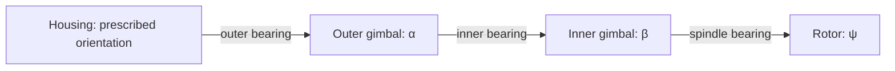

# Gyroscope mechanics: from a turn indicator to two gimbals

Educational derivation · 24 October 2026

This document develops the physical model for an interactive aircraft-gyroscope demonstrator. Its companion, [Simulation design](02-simulation-design.md), specifies how to implement and present that model. The [original design paper](../gyroscope-simulation-design.md) is preserved as background.

Each main topic starts with an observation a learner can make, then develops the mathematics needed to explain it. The conceptual passages assume basic ATPL instrument knowledge; the derivations additionally use vectors, differentiation, and matrices. The [interactive browser lab](../README.md#run-the-browser-lab) now implements all three mechanisms; [native command-line experiments](../README.md#try-the-attitude-and-directional-gyros) are also available. Later physical influences described below remain extensions unless explicitly identified as implemented.

## 1. What the learner should be able to explain

A spinning rotor stores angular momentum. Its supports determine which motions are possible and which torques can act on it. Changing those supports turns the same underlying mechanics into different instruments:

| Mechanism | Observation | Learning objective |
|---|---|---|
| One-gimbal turn indicator | The restrained gimbal deflects during housing rotation and returns when rotation stops | Distinguish angular rate from attitude; explain spring restraint and damping |
| Two-gimbal attitude gyro | The housing rotates around an approximately steady spindle direction | Explain a vertical reference and why erection is a separate mechanism |
| Two-gimbal directional gyro | The housing's yaw changes its angle relative to the gyro | Explain a direction reference and why it does not seek magnetic north |

These represent conventional mechanical arrangements described in the [FAA Instrument Flying Handbook][faa] and [AP3456, Volume 5][ap3456]. Actual instruments differ in gearing, support geometry, limits, and correction systems. An ADI is a display that can include flight-director information and can receive attitude from another system; this project models the mechanical attitude reference, not flight-director guidance.

After the demonstrations, a learner should be able to predict the effect of reversing spin, changing rotor speed, adding damping, and changing the housing rotation axis. They should also distinguish physical precession from an animation convention, and instrument limitations from numerical errors.

## 2. The mechanism and its coordinates

### 2.1 What is moved, and what is free?

The learner drags the **housing**, the part attached to the aircraft. A gimbal is an internal support that turns freely about its own bearing axis, subject to any explicitly modelled spring or damping. Dragging the housing does not set the internal gimbal angles.

All bodies are rigid, share a fixed pivot, and have their centres of mass at that pivot. The housing orientation is prescribed. Its actuator can exert torque and exchange energy with the assembly. Aircraft translation, Earth rotation, offsets of the centres of mass, structural flexibility, and contact between parts are initially omitted.

For one gimbal the dynamic coordinates are

$$
q=(\theta,\psi),
$$

where $\theta$ is the gimbal angle and $\psi$ is the rotor angle relative to that gimbal. With two gimbals they are

$$
q=(\alpha,\beta,\psi).
$$

Here $\alpha$ is the outer-gimbal angle and $\beta$ the inner-gimbal angle. Thus “one gimbal freedom” or “two gimbal freedoms” excludes rotor spin; the mechanical model has two or three internal coordinates respectively. Prescribing the housing motion does not add another unknown coordinate.

The gimbals have finite, nonzero inertia. Setting their inertia to zero is a separate idealisation and can change the character of the equations.

### 2.2 Frames, signs, and units

Use a right-handed aircraft frame $B$: $x$ forward, $y$ right, $z$ down. A fixed laboratory frame $W$ initially coincides with $B$. Positive rotations follow the right-hand rule: positive roll lowers the right wing, positive pitch raises the nose, and positive yaw turns the nose right in the initial level attitude.

$R_i$ maps components in body $i$ to world components:

$$
\boldsymbol v^W=R_i\boldsymbol v^i.
$$

Products act on column vectors from right to left. For example,

$$
R_x(\theta)=
\begin{pmatrix}
1&0&0\\
0&\cos\theta&-\sin\theta\\
0&\sin\theta&\cos\theta
\end{pmatrix}.
$$

Each joint axis is specified in its parent frame, so its world direction moves with that parent. A coordinate rate such as $\dot\alpha$ is not generally a Cartesian component of angular velocity.

| Symbol | Meaning | SI unit |
|---|---|---|
| $q,\psi$ | Joint angles; rotor spin angle | rad |
| $\boldsymbol\omega$ | Angular velocity vector | rad/s |
| $\Omega$ | Housing yaw rate in the one-gimbal worked example | rad/s |
| $I_s,I_\perp$ | Rotor axial and transverse moments of inertia | kg m² |
| $h$ | Signed rotor axial angular momentum | N m s |
| $Q_j$ | Generalized torque for joint $j$ | N m |
| $k,c$ | Torsional stiffness and viscous damping coefficient | N m/rad; N m s/rad |

Use SI throughout the equations. Convert degrees and RPM at the interface: $\dot\psi=2\pi\,\mathrm{RPM}/60$. Radians are dimensionless in dimensional analysis.

### 2.3 Angular momentum and rigidity

For a body with inertia tensor $I$, expressed in the same axes as its angular velocity,

$$
T=\tfrac12\boldsymbol\omega^T I\boldsymbol\omega,
\qquad \boldsymbol H=I\boldsymbol\omega.
\tag{1}
$$

The inertia tensor accounts for how mass is distributed relative to the pivot:

$$
I=\int\left[(\boldsymbol r\cdot\boldsymbol r)\mathbf 1
-\boldsymbol r\boldsymbol r^T\right]dm.
$$

An axisymmetric rotor has equal transverse inertias. With unit local spindle direction $\boldsymbol s_0$,

$$
I_R=I_\perp\mathbf1+(I_s-I_\perp)\boldsymbol s_0\boldsymbol s_0^T.
\tag{2}
$$

The angular-momentum law is $d\boldsymbol H^W/dt=\boldsymbol\tau^W$. At high spin, $\boldsymbol H_R\simeq h\boldsymbol s$, where $\boldsymbol s$ is the spindle direction in space. A small torque changes a large angular momentum relatively slowly. This is the origin of approximate rigidity in space; it is not a rule that freezes the spindle.

For a slowly precessing high-spin rotor,

$$
\boldsymbol\tau\simeq\boldsymbol\Omega_p\times(h\boldsymbol s).
\tag{3}
$$

When precession and the spindle are perpendicular, $|\Omega_p|\simeq|\tau|/|h|$. The vector cross product explains the perpendicular response. A “90-degree” explanation must not become a time delay in the simulation. Transient oscillation of the spindle, called nutation, requires the full dynamics. See the [MIT gyroscope lecture][mit-gyro] for the distinction between general motion and steady-precession approximations.

## 3. A short introduction to Lagrangian mechanics

### 3.1 Why start with energy?

A bearing can exert forces and torques in constrained directions. Writing every reaction explicitly is possible, but obscures the small number of motions that remain free. Joint angles already satisfy the geometry. Lagrangian mechanics gives equations directly for those angles, with ideal constraint reactions eliminated from their permitted motions. It expresses the same mechanics as Newton's laws; see the [MIT Lagrange lecture][mit-lagrange].

The construction is:

1. Choose independent coordinates $q_j$.
2. Calculate kinetic energy $T(q,\dot q,t)$ and potential energy $V(q,t)$.
3. Form $L=T-V$.
4. For each coordinate, apply

$$
\boxed{\frac{d}{dt}\frac{\partial L}{\partial\dot q_j}
-\frac{\partial L}{\partial q_j}=Q_j.}
\tag{4}
$$

$Q_j$ contains applied effects not already accounted for by $V$. Define it through virtual work, $\delta W=\sum_jQ_j\delta q_j$. A damper contributes a torque to $Q_j$; a spring can instead be represented in $V$. Counting a spring in both places would double its effect.

The partial derivative $\partial L/\partial\dot q_j$ treats coordinates and rates as independent arguments. The outer derivative $d/dt$ then follows their actual evolution, including any prescribed housing motion.

### 3.2 Where does the equation come from?

For a conservative system consider the action $S=\int_{t_0}^{t_1}L\,dt$. Perturb a possible path by $\delta q_j$, holding the endpoint configurations fixed. Integration by parts gives

$$
\delta S=\int_{t_0}^{t_1}\sum_j
\left(\frac{\partial L}{\partial q_j}
-\frac{d}{dt}\frac{\partial L}{\partial\dot q_j}\right)\delta q_j\,dt.
$$

Stationarity for arbitrary admissible variations gives the unforced equation. Including applied virtual work, $\delta S+\int\sum_jQ_j\delta q_j\,dt=0$, gives (4). Stationarity does not necessarily mean a minimum, and it does not mean that instantaneous energy is minimised.

An ideal moving constraint does no virtual work in an allowed variation at fixed time, but its actuator can do actual work as time passes. This matters when the learner rotates the housing.

### 3.3 Warm-up: a restrained rotating frame

Imagine twisting a frame against a torsion spring, then releasing it. Inertia carries it past equilibrium; damping dissipates energy.

For inertia $J$, spring stiffness $k$, and angle $\theta$,

$$
T=\tfrac12J\dot\theta^2,\qquad V=\tfrac12k\theta^2,
\qquad Q_\theta=\tau-c\dot\theta.
$$

The derivatives are $\partial L/\partial\dot\theta=J\dot\theta$ and $\partial L/\partial\theta=-k\theta$. Equation (4) becomes

$$
J\ddot\theta+c\dot\theta+k\theta=\tau.
\tag{5}
$$

The three left-hand terms are inertia, damping, and restoring torque. We will obtain a similar equation for the turn indicator, but derive its driving term from the spinning rotor rather than prescribe that term by hand.

## 4. Worked example: a one-gimbal turn indicator

### 4.1 Predict the observation

Start with the housing at rest, the gimbal centred, and the rotor spinning about aircraft $+y$. Rotate the housing steadily about $+z$. The gimbal, free about $+x$, deflects against its spring. After settling, its angle indicates the imposed rate. Hold the housing at its new orientation with zero rate: the gimbal returns toward zero.

The contrast between rotating continuously and merely being rotated is the central lesson. A conventional turn gyro senses a component of angular velocity; in a general attitude, body-axis yaw rate is not simply the time derivative of heading. The slip/skid ball is a separate mechanism, outside this model.

### 4.2 Specify the geometry

For this worked experiment, the housing undergoes pure yaw:

$$
R_B=R_z(\phi(t)),\quad \Omega(t)=\dot\phi(t),\quad
R_G=R_B R_x(\theta),\quad R_R=R_G R_y(\psi).
\tag{6}
$$

Its yaw rate may vary smoothly with time. Arbitrary housing rotation is addressed in Section 6.

Let the gimbal inertia in its principal axes be $\operatorname{diag}(G_x,G_y,G_z)$. Transforming the housing angular velocity into gimbal axes gives

$$
R_x(-\theta)\begin{pmatrix}0\\0\\\Omega\end{pmatrix}
=\begin{pmatrix}0\\\Omega\sin\theta\\\Omega\cos\theta\end{pmatrix}.
$$

Adding the gimbal rate therefore gives

$$
\boldsymbol\omega_G^G=
\begin{pmatrix}\dot\theta\\\Omega\sin\theta\\\Omega\cos\theta\end{pmatrix}.
\tag{7}
$$

The rotor adds $\dot\psi$ along $+y$. Because its transverse inertias are equal, its energy can be evaluated in the supporting gimbal axes without tracking the spin phase:

$$
T_R=\tfrac12 I_\perp(\dot\theta^2+\Omega^2\cos^2\theta)
+\tfrac12 I_s(\dot\psi+\Omega\sin\theta)^2.
\tag{8}
$$

The quantity in the last parentheses is the **absolute axial angular velocity**. It differs from the bearing-relative rate $\dot\psi$.

### 4.3 Build the Lagrangian

Adding the gimbal energy, define

$$
J=G_x+I_\perp,\qquad
C(\theta)=G_y\sin^2\theta+(G_z+I_\perp)\cos^2\theta.
$$

Then

$$
L=\tfrac12J\dot\theta^2+\tfrac12\Omega^2 C(\theta)
+\tfrac12I_s(\dot\psi+\Omega\sin\theta)^2-\tfrac12k\theta^2.
\tag{9}
$$

Use $Q_\theta=-c\dot\theta$ and a net rotor joint torque $Q_\psi$, whose motor and loss terms are specified in Section 7. The spring is already in $L$.

Since $L$ is independent of the rotor angle $\psi$, that angle is a **cyclic coordinate**. Its conjugate momentum is

$$
h=\frac{\partial L}{\partial\dot\psi}
=I_s(\dot\psi+\Omega\sin\theta),\qquad \dot h=Q_\psi.
\tag{10}
$$

With zero spin torque, $h$ is constant even while the housing moves. Constant $h$ does not imply constant bearing-relative RPM.

### 4.4 Differentiate, then interpret

The derivatives needed for the gimbal equation are

$$
\frac{d}{dt}\frac{\partial L}{\partial\dot\theta}=J\ddot\theta,
\qquad
\frac{\partial L}{\partial\theta}
=\tfrac12\Omega^2 C'(\theta)+h\Omega\cos\theta-k\theta,
$$

where $C'=2(G_y-G_z-I_\perp)\sin\theta\cos\theta$. Therefore

$$
\boxed{J\ddot\theta+c\dot\theta+k\theta
=h\Omega\cos\theta
+(G_y-G_z-I_\perp)\Omega^2\sin\theta\cos\theta.}
\tag{11}
$$

The spin acceleration follows by differentiating (10):

$$
\boxed{\ddot\psi=\frac{Q_\psi}{I_s}
-\dot\Omega\sin\theta-\Omega\cos\theta\,\dot\theta.}
\tag{12}
$$

Equations (10)–(12) are exact for the specified concentric mechanism and pure-yaw input. They retain finite deflection and time-dependent yaw rate. There is no explicit $\dot\Omega$ term in (11) for this particular geometry; it does enter (12). General housing motion introduces further terms.

The first right-hand term of (11) is the gyroscopic drive. The second comes from the transverse inertia and imposed rotation. At $\theta=0$, a positive yaw rate acting on positive $h$ initially produces positive gimbal acceleration. Equivalently, turning a rotor momentum along $+y$ about $+z$ requires a torque along $-x$; the rotor's reaction drives its support toward $+x$.

There is no direct $Q_\psi$ term in (11), because the spin and gimbal axes are perpendicular. Motor action still changes $h$ and the bearing reactions; its reaction torque has not disappeared.

### 4.5 Obtain the familiar rate-gyro approximation

For small $\theta$, replace $\cos\theta$ by 1. Neglect the $\Omega^2$ term when its magnitude is small compared with the retained torques, and take $h$ as approximately constant over the response. Then

$$
\boxed{J\ddot\theta+c\dot\theta+k\theta\simeq h\Omega.}
\tag{13}
$$

This approximation follows from (11); it is not an independent simulation rule. For a settled response,

$$
\theta_{\rm eq}\simeq\frac{h}{k}\Omega.
\tag{14}
$$

The spring converts a rate-dependent torque into a measurable angle. With $k=0$, there is no spring-calibrated steady deflection. The small-signal natural frequency is $\sqrt{k/J}$, and the damping ratio is $c/(2\sqrt{Jk})$. Damping changes settling and overshoot without changing the steady result (14).

Spin reversal reverses the leading deflection. Reducing spin reduces sensitivity. At zero spin the full equations remain defined: ordinary inertial response can still occur, but the leading gyroscopic drive vanishes. The approximation $\Omega_p\sim\tau/h$ must never be used through zero spin.

### 4.6 A numerical scale for the classroom

Take an illustrative thin disc with mass $0.10$ kg, radius $0.025$ m, and initial spin $12{,}000$ RPM. Neglect its thickness:

$$
I_s=\tfrac12mr^2=3.125\times10^{-5}\;\mathrm{kg\,m^2},\qquad
I_\perp=\tfrac14mr^2=1.5625\times10^{-5}\;\mathrm{kg\,m^2}.
$$

The initial bearing-relative rate is $1256.637$ rad/s. With a stationary support, $h=0.0392699$ N m s. At $3^\circ$/s, corresponding to a two-minute complete turn, $h\Omega=0.00205617$ N m.

Choose $G_x=G_y=G_z=2\times10^{-5}$ kg m² and an illustrative $10^\circ$ deflection at the nominal rate. The small-signal calibration gives

$$
k=\frac{h_{\rm nominal}\Omega_{\rm ref}}{\theta_{\rm ref}}
=0.01178097\;\mathrm{N\,m/rad},\quad
J=3.5625\times10^{-5}\;\mathrm{kg\,m^2}.
$$

For damping ratio 0.7, $c=0.00090698$ N m s/rad. The undamped natural frequency is about $18.185$ rad/s. These are teaching parameters, not measurements of an aircraft instrument. Even $10^\circ$ is a finite angle, so the exact settled result will differ from (14); the reference mark expresses the nominal small-signal calibration.

**Experiment:** ramp to a small constant yaw rate, wait for settling, then ramp to zero. Predict the needle direction first. Repeat with reversed spin and with lower RPM. For quantitative comparisons with (14), decrease the test rate so that finite-angle error becomes negligible.

## 5. Extending the model to two gimbals

### 5.1 What the extra freedom changes

With two gimbals, the spindle can change direction relative to the housing in two independent directions over its normal geometric range. This permits an approximately inertially steady reference while the housing changes attitude. It does not eliminate bearing reactions or guarantee perfect rigidity when gimbal inertia is finite.

The configurations at zero joint angles are:

| Preset | Outer axis in housing | Inner axis in outer gimbal | Spindle in supporting gimbal |
|---|---|---|---|
| Attitude gyro | $x$ | $y$ | $z$ |
| Directional gyro | $z$ | $x$ | $y$ |

For the attitude configuration,

$$
R_O=R_B R_x(\alpha),\quad
R_G=R_O R_y(\beta),\quad
R_R=R_G R_z(\psi).
\tag{15}
$$

For the DG, replace the sequence by $z,x,y$. The mathematical extension is to add the outer body's energy and its contribution to the angular velocities of all descendants, then apply one more Lagrange equation.

### 5.2 A fully worked fixed-housing reference

Fix $R_B=\mathbf1$, use the attitude configuration, and omit spring potential for this example. Let the outer gimbal's inertia about its bearing axis be $A$, and the inner gimbal's principal inertias be $B_1,B_2,B_3$.

The inner-gimbal angular velocity in its own axes is

$$
\boldsymbol\omega_G^G=
\begin{pmatrix}\dot\alpha\cos\beta\\\dot\beta\\\dot\alpha\sin\beta\end{pmatrix}.
$$

The rotor adds $\dot\psi$ along its third axis. Define

$$
D(\beta)=A+(B_1+I_\perp)\cos^2\beta+B_3\sin^2\beta,
\qquad J_\beta=B_2+I_\perp.
$$

The total energy is

$$
T=\tfrac12D\dot\alpha^2+\tfrac12J_\beta\dot\beta^2
+\tfrac12I_s(\dot\psi+\dot\alpha\sin\beta)^2.
\tag{16}
$$

The spin momentum is again cyclic:

$$
h=I_s(\dot\psi+\dot\alpha\sin\beta),\qquad \dot h=Q_\psi.
\tag{17}
$$

To see the differentiation explicitly,

$$
\frac{\partial L}{\partial\dot\alpha}=D\dot\alpha+h\sin\beta,
\quad \frac{\partial L}{\partial\alpha}=0,
\quad \frac{\partial L}{\partial\beta}
=\tfrac12D'\dot\alpha^2+h\dot\alpha\cos\beta.
$$

Consequently,

$$
\boxed{D\ddot\alpha+D'\dot\alpha\dot\beta
+h\cos\beta\,\dot\beta+\dot h\sin\beta=Q_\alpha,}
\tag{18}
$$

$$
\boxed{J_\beta\ddot\beta-\tfrac12D'\dot\alpha^2
-h\cos\beta\,\dot\alpha=Q_\beta,}
\tag{19}
$$

where $D'=2(B_3-B_1-I_\perp)\sin\beta\cos\beta$. Recover the relative spin acceleration from

$$
\ddot\psi=Q_\psi/I_s-\ddot\alpha\sin\beta
-\dot\alpha\dot\beta\cos\beta.
\tag{20}
$$

The $\dot h\sin\beta$ term in (18) is particularly important when a motor acts. Keeping the rotor speed fixed by overwriting a state variable would bypass this coupling.

### 5.3 Precession and nutation in the equations

Near $\beta=0$, for constant $h$ and small gimbal rates, let $J_\alpha=A+B_1+I_\perp$. The leading equations become

$$
J_\alpha\ddot\alpha+h\dot\beta=Q_\alpha,
\qquad J_\beta\ddot\beta-h\dot\alpha=Q_\beta.
\tag{21}
$$

When the acceleration terms are small, torque about one joint produces motion about the other: $\dot\beta\simeq Q_\alpha/h$ and $\dot\alpha\simeq-Q_\beta/h$. An abrupt torque also excites a transient; the steady approximation cannot describe its start.

For zero applied torques, differentiating the first equation and using the second gives

$$
\frac{d^2\dot\alpha}{dt^2}
+\frac{h^2}{J_\alpha J_\beta}\dot\alpha=0,
\qquad \omega_n=\frac{|h|}{\sqrt{J_\alpha J_\beta}}.
\tag{22}
$$

The joint rates oscillate. With all gimbal principal inertias $2\times10^{-5}$ kg m² and the rotor above, the small-motion nutation frequency is about $882.16$ rad/s, or $140.40$ Hz. It is much faster than the turn indicator's spring response. A solver must resolve this mode even if the visible precession looks slow.

**Experiment:** use a repeatable smooth housing manoeuvre, compare low and high spin, and inspect spindle direction and gimbal-rate traces. A separate native test can apply known joint torques to verify (21); the initial browser interface does not include gimbal dragging.

### 5.4 Eliminating rotor phase without losing the effect

Axisymmetry removes $\psi$ from the energy, but not the spin rate or angular momentum. For the fixed-housing example with constant $h$, eliminating $\dot\psi$ requires the Routhian

$$
\mathcal R=L-h\dot\psi
=\tfrac12D\dot\alpha^2+\tfrac12J_\beta\dot\beta^2
+h\dot\alpha\sin\beta-\frac{h^2}{2I_s}.
\tag{23}
$$

Applying Lagrange's equations to $\mathcal R$ at fixed $h$ recovers (18)–(19) with $\dot h=0$. Simply substituting for $\dot\psi$ in $L$ and treating the result as a reduced Lagrangian loses the gyroscopic term. The initial implementation retains the full joint rates to support powered operation; it exploits phase independence only when evaluating inertia and rendering.

## 6. Arbitrary housing motion and a common solver

### 6.1 Assemble the energies

The learner can rotate the housing about any axis, not only the yaw axis used in Section 4. At each instant, let $\boldsymbol a_j^W$ be a joint axis and include that axis for every body downstream of the joint, including its own body. Then

$$
\boldsymbol\omega_i^W=\boldsymbol\omega_B^W
+\sum_{j\in\operatorname{ancestors}(i)}\dot q_j\boldsymbol a_j^W.
\tag{24}
$$

For $I_i^W=R_iI_i^iR_i^T$,

$$
T=\tfrac12\sum_i(\boldsymbol\omega_i^W)^T I_i^W\boldsymbol\omega_i^W.
\tag{25}
$$

The sum includes gimbals and rotor, not the prescribed housing. With the present balanced, common-pivot assumption there is no centre-of-mass translation energy. Springs contribute to $V$; motors and damping contribute to $Q$.

Let $v=\dot q$, $p=\partial L/\partial v$, and $M=\partial^2L/\partial v\partial v^T$. Expanding (4),

$$
M\ddot q=Q+\frac{\partial L}{\partial q}
-\frac{\partial p}{\partial q}v
-\left.\frac{\partial p}{\partial t}\right|_{q,v}.
\tag{26}
$$

The last term contains prescribed housing motion. Housing orientation, angular velocity, and angular acceleration must describe one consistent trajectory and be evaluated at each solver stage time.

### 6.2 An equivalent form convenient for Rust

Define a $3\times n$ angular Jacobian $J_i$ whose ancestor columns are $\boldsymbol a_j^W$, with other columns zero. The time derivative of an axis is

$$
\dot{\boldsymbol a}_j^W
=\boldsymbol\omega_{\operatorname{parent}(j)}^W\times\boldsymbol a_j^W.
$$

The body angular acceleration can then be written

$$
\boldsymbol\alpha_i^W=J_i\ddot q+\boldsymbol\gamma_i,
\qquad
\boldsymbol\gamma_i=\boldsymbol\alpha_B^W
+\sum_{j\in\operatorname{ancestors}(i)}\dot q_j\dot{\boldsymbol a}_j^W.
$$

Projecting each body's required torque onto the permitted virtual rotations gives

$$
\boxed{
\begin{aligned}
M&=\sum_i J_i^T I_i^W J_i,\\
b&=Q-\nabla_q V-\sum_iJ_i^T
\left[I_i^W\boldsymbol\gamma_i
+\boldsymbol\omega_i^W\times(I_i^W\boldsymbol\omega_i^W)\right],\\
M\ddot q&=b.
\end{aligned}
}
\tag{27}
$$

This is an implementation form of the same constrained dynamics. The cross product is essential; it follows from differentiating angular momentum with a rotating inertia tensor, equivalently [Euler's rigid-body equations][mit-euler]. Parent angular velocities exclude the child's relative rate. In particular, the spin-axis derivative uses its supporting gimbal's velocity.

Solve the small linear system rather than forming an inverse. For the finite, positive body inertias specified here, $M$ is symmetric positive definite. Equations (11)–(12) and (18)–(20) give independent special cases against which to test this general construction.

## 7. Powered operation, coasting, and energy

### 7.1 Three different meanings of speed

**Initial RPM** sets $\dot\psi$ on reset. **Target RPM** is a command to a motor during a run. **Absolute axial speed** is $h/I_s$, which includes the support's angular velocity projected onto the spindle. These quantities coincide for an initially stationary support, but not in general.

Use a bounded motor torque with optional viscous spin loss:

$$
\tau_m=\operatorname{clip}\left[K_m(\dot\psi_{\rm target}-\dot\psi),
-\tau_{m,\max},\tau_{m,\max}\right],
\qquad Q_\psi=\tau_m-c_s\dot\psi.
\tag{28}
$$

The motor regulates bearing-relative speed. It need not maintain the target exactly under changing load, and its torque can saturate. Motor and bearing torques act equally and oppositely on rotor and support; representing them as a joint torque accounts for their virtual work on the complete assembly.

Coast sets $\tau_m=0$. With $c_s=0$, the rotor's axial momentum is conserved; coasting alone does not imply spin-down. With $c_s>0$ and a stationary support, $\dot\psi$ decays exponentially with time constant $I_s/c_s$. Motor spin reversal must pass continuously through zero speed.

### 7.2 What should be conserved?

For fixed housing, ideal bearings, zero motor torque, and no external work, physical energy $E=T+V$ is conserved. In the spring-free two-gimbal fixed-housing example, $h$ and

$$
p_\alpha=D\dot\alpha+h\sin\beta
\tag{29}
$$

are also conserved. The housing can exert constraint torques, so the entire assembly's angular-momentum vector need not be constant. Do not use that as a conservation test for this supported system.

With moving housing, let $\boldsymbol\tau_B^W$ denote the net torque exerted by the housing on the modelled assembly, including its spring/damper connections. For this model,

$$
\frac{dE}{dt}=\boldsymbol\tau_B^W\cdot\boldsymbol\omega_B^W
+\tau_m\dot\psi-c_s\dot\psi^2-\sum_{j\in\text{gimbals}}c_j\dot q_j^2.
\tag{30}
$$

The net housing torque follows from the sum of the body angular-momentum derivatives; internal motor and inter-body torques cancel in that sum. Housing work is not a numerical error. In prescribed moving coordinates the canonical quantity $v^Tp-L$ need not equal physical $T+V$; energy diagnostics should use the latter.

For constant-$h$ runs, also examine $E-h^2/(2I_s)$. The large constant spin energy can otherwise hide a substantial relative error in the much smaller gimbal-motion energy.

## 8. Reading the instruments and recognising limits

### 8.1 Attitude and directional references

For the attitude preset, initialise the geometrical spindle direction along world down. Express that simulated direction in housing axes to construct the horizon. Reversing spin reverses angular momentum, not the definition of which geometrical spindle end is the down reference. Never derive the displayed horizon directly from the commanded housing orientation: that would conceal gyro motion.

For the DG, use the relative outer-gimbal angle and a heading-setting offset. It is a direction memory, not a north-seeking sensor. A simplified directly geared card can be specified without reproducing every linkage in a real instrument. At general bank and pitch, its reading is the result of the mechanism and need not equal ideal geographical heading.

### 8.2 Mechanical gimbal lock

For the attitude sequence, at $\beta=\pm\pi/2$ the outer bearing and spindle axes align. Turning the outer gimbal then gives no new spindle-pointing direction. The DG sequence has the corresponding alignment at the same inner angle.

This is a property of the mechanism. Quaternions prevent some orientation-coordinate singularities, but do not restore a missing physical pointing direction. Finite gimbal inertia can keep the full dynamic mass matrix nonsingular even at this alignment. Loss of pointing freedom and numerical matrix conditioning must therefore be diagnosed separately.

The initial model has no mechanical stops or collision response. Passing through an alignment is possible in its ideal geometry; it does not simulate the impacts or tumbling of a specific instrument.

### 8.3 Gravity and later effects

Because each centre of mass lies at the pivot, gravity supplies no orientation-dependent potential in the current model. A balanced attitude gyro does not become upright merely because gravity exists. Real erection mechanisms supply correcting torques using their own sensing arrangements; [AP3456][ap3456] describes examples.

| Extension | Additional model required | Observable lesson |
|---|---|---|
| Erection and acceleration errors | Gravity/acceleration sensing, actuator dynamics, and later aircraft translation | A sensed vertical can differ from true vertical |
| Bearing friction and drive failure | Loss and drive models beyond the optional simple viscous spin term | Drift, sensitivity loss, and transient response |
| Stops and caging | Contact/constraint laws and explicit engagement rules | Restricted travel and changed degrees of freedom |
| Earth rotation and transport | A local navigation frame rotating relative to inertial space; position and motion inputs | Apparent drift depends on reference-frame motion |
| Offset centres of mass | Translational kinetic energy and gravity potential | Unbalance introduces torque |
| Turn coordinator and slip/skid ball | A canted gyro arrangement and a separate acceleration-sensitive ball model | Roll-rate response differs from turn rate and coordination |

These are extensions, not effects that should be represented by arbitrary angle corrections in the first model.

## 9. Experiments and evidence

| Experiment or check | Expected result | Conditions that matter |
|---|---|---|
| Rotate the turn-indicator housing, then hold it still | Deflection during rotation; return toward centre after stopping | Spring and damping enabled |
| Reverse rotor spin | Leading gyroscopic response reverses | Compare the same input and initial gimbal state |
| Coast without spin loss | $h$ remains constant | Relative RPM can still change with support motion |
| Run at zero spin | Finite ordinary constrained dynamics | No division by $h$ |
| Small steady yaw rate | $\theta\simeq h\Omega/k$ | Reduce rate to expose the small-angle limit |
| Unforced two-gimbal small motion | Rate oscillation approaches (22) | Small amplitudes, fixed housing, constant $h$ |
| Fixed-housing conservation | Appropriate energy and momenta remain constant to numerical accuracy | Apply only the invariants valid for the chosen forces |
| Move housing or power motor | Energy change matches work and losses in (30) | Include actuator work |
| Halve the integration step | Smooth resolved trajectories converge | Compare the same physical input at the same simulation times |

The [implementation document](02-simulation-design.md#9-validation-and-acceptance) turns these into acceptance cases and separates approximation error from integration error.

The original paper reports a 200-state comparison with automatic differentiation and an RK4 step-halving ratio of 16.04. Its supporting programs and fixtures are absent from this directory. Those are historical reported results, not evidence for the current implementation. Separate retained tests now cover [one-gimbal physics](../crates/gyro-core/tests/physics.rs), [two-gimbal physics](../crates/gyro-core/tests/two_gimbal.rs), [independent moving-housing energy derivatives](../crates/gyro-core/tests/energy_reference.rs), and [native/WASM parity](../web/tests/parity.mjs). The [README evidence summary](../README.md#verify-the-implementation) records their scope and measured values; selected fixtures do not establish a general parameter envelope or certified aircraft-instrument behavior.

## References

- [FAA, Instrument Flying Handbook, Chapter 5][faa]: conventional gyroscopic instruments and their indications.
- [UK Ministry of Defence, AP3456, Volume 5: Flight Instruments][ap3456]: gyroscope principles and mechanical instrument arrangements, especially Chapters 11 and 21.
- [MIT OpenCourseWare, 16.07, Lecture 20: Energy Methods — Lagrange's Equations][mit-lagrange]: the analytical-mechanics foundation.
- [MIT OpenCourseWare, 16.07, Lecture 28: Euler's Equations][mit-euler]: rigid-body dynamics in rotating axes.
- [MIT OpenCourseWare, 16.07, Lecture 30: Tops and Gyroscopes][mit-gyro]: precession and general gyroscopic motion.

The specific equations and example parameters above are for the geometry defined in this document. They are not manufacturer specifications or a claim of complete ATPL syllabus coverage.

[faa]: https://www.faa.gov/sites/faa.gov/files/pilots/FAA-H-8083-15B.pdf
[ap3456]: https://assets.publishing.service.gov.uk/media/5e18affaed915d3b1410a57f/Volume_05_Flight_Instruments.pdf
[mit-lagrange]: https://ocw.mit.edu/courses/16-07-dynamics-fall-2009/b39e882f1524a0f6a98553ee33ea6f35_MIT16_07F09_Lec20.pdf
[mit-euler]: https://ocw.mit.edu/courses/16-07-dynamics-fall-2009/5e1d8699338146e5127080b880b906d6_MIT16_07F09_Lec28.pdf
[mit-gyro]: https://ocw.mit.edu/courses/16-07-dynamics-fall-2009/99f271d601bb3d9d04e8b8ce0c73cb7a_MIT16_07F09_Lec30.pdf
