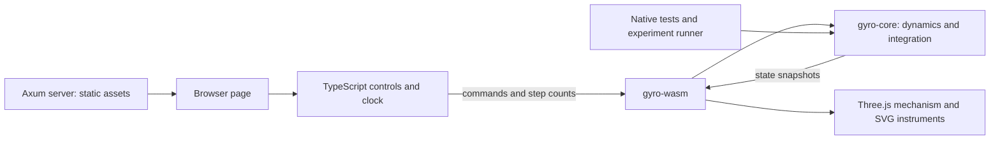
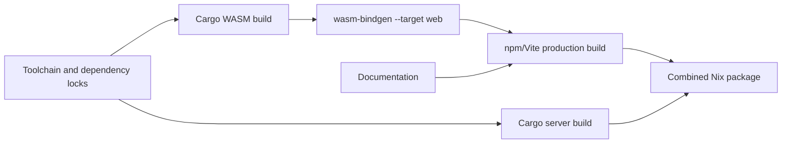

# Gyroscope simulator: Rust, WebAssembly, browser, and Nix design

Implementation specification · 24 October 2026

This document specifies the application built from [Gyroscope mechanics](01-gyroscope-mechanics.md). Both native implementation stages are complete: `gyro-core` implements all three mechanisms, general housing kinematics, analytic yaw/pitch/roll inputs, a coupled manual follower, motor/coast controls, instrument and work/energy diagnostics, and deterministic command replay. See the [project README](../README.md) for commands and reproducible tests. WASM/browser presentation is next; the server and Nix packaging follow. The [original paper](../gyroscope-simulation-design.md) remains available as background.

## 1. Intended behavior and scope

An ATPL learner opens a local web page, selects an attitude gyro, directional gyro, or turn indicator, and rotates the instrument housing with the mouse. Rust code running in the browser computes the internal gimbal response. An exposed 3D mechanism, a simplified instrument face, and optional numerical traces show the same simulated state.

The first implementation covers balanced concentric rigid bodies, finite gimbal inertia, an axisymmetric spinning rotor, a motor with a target speed and bounded torque, optional simple viscous spin loss, and turn-indicator spring/damping. It starts powered at the selected initial RPM. A coast control disables the motor without changing the state.

The first browser interface manipulates the housing only. Detailed bearing friction, erection, caging, stops, collision/tumbling models, aircraft translation, Earth rotation, transport, turn-coordinator geometry, and the slip/skid ball are later extensions. The attitude preset represents a mechanical attitude reference, not flight-director guidance or a complete ADI system.

Success means that the mechanism's behavior follows from the equations, that a learner can distinguish rate from attitude, and that the same experiments can be replayed in native Rust and WASM with numerically consistent results.

## 2. Architecture and responsibilities



| Component | Owns | Must not own |
|---|---|---|
| `gyro-core` | Parameters, joint geometry, housing driver, forces, integration, state, diagnostics, command ordering | DOM, wall-clock timing, HTTP, rendering |
| `gyro-wasm` | `wasm-bindgen` exports and conversion between Rust values and JavaScript objects | A second implementation of physics |
| Browser TypeScript | Input events, animation scheduling, camera, meshes, controls, plots, snapshot interpolation | Gyroscopic corrections or direct edits to dynamic state |
| `gyro-server` | Axum/Tokio listener and static-file serving with `tower-http` | Simulation sessions or a server-side simulation loop |
| Nix flake | Pinned toolchain, native/WASM/web builds, test environment, runnable package | Runtime network dependency fetching |

Use a Cargo workspace with `crates/gyro-core`, `crates/gyro-wasm`, and `crates/gyro-server`; keep the browser project under `web`. `gyro-core` uses ordinary Rust and `f64` mathematics with no browser dependencies. The native first stage implements the required small vector, quaternion, and matrix operations directly and has no external dependencies. A general-purpose rigid-body engine is unnecessary.

Use TypeScript and Three.js for the scene, plain HTML/CSS for controls, SVG for instrument faces and simple bounded-history plots, and Vite for bundling. No UI framework is required for this initial interface. [wasm-bindgen][wasm-bindgen] generates the Rust/JavaScript bridge and TypeScript declarations. [Three.js WebGLRenderer][three] uses WebGL 2; unsupported browsers should receive a clear message before simulation starts.

Keep physics on the browser main thread initially, advancing many small steps per WASM call. Benchmark this before introducing a worker. A future worker can retain the same command/snapshot contract.

## 3. Physical model and initialization

### 3.1 Coordinates and shared dynamics

Use the conventions from the mechanics document: aircraft $x$ forward, $y$ right, $z$ down; right-handed rotations; body-to-world orientations; SI units internally. Store joint angles and rates in this order:

| Preset | Coordinates | Parent-relative joint axes at zero angles | Restoring terms |
|---|---|---|---|
| `TurnIndicator` | $[\theta,\psi]$ | $[x,y]$ | Spring and viscous damping on $\theta$ |
| `Attitude` | $[\alpha,\beta,\psi]$ | $[x,y,z]$ | No gimbal spring or damping by default |
| `Directional` | $[\alpha,\beta,\psi]$ | $[z,x,y]$ | No gimbal spring or damping by default |

Implement the angular-Jacobian formulation in mechanics equation (27). At every derivative evaluation:

1. Obtain consistent housing orientation, angular velocity, and angular acceleration at that stage.
2. Traverse the joint chain, computing body orientations, world joint axes, parent angular velocities, and axis derivatives.
3. Compute body angular velocities and world inertia tensors; assemble $M$ and the inertial bias terms.
4. Add motor/loss torques to $Q$, damping to its gimbal entries, and spring forces through $-\nabla V$ exactly once.
5. Solve $M\ddot q=b$ using a checked Cholesky factorization; return $\dot q=v$ and $\dot v=\ddot q$.

The rotor's world inertia depends on its spindle direction but not its spin phase. Compute it directly as $I_\perp\mathbf1+(I_s-I_\perp)\boldsymbol s\boldsymbol s^T$. Retain rotor rate and phase in state; phase is useful for display but does not require resolving every revolution in the dynamics.

Keep the explicit one-gimbal pure-yaw equations and fixed-housing two-gimbal equations as independent test references. Automatic differentiation can support test development; production need not differentiate energy numerically or symbolically at runtime.

### 3.2 Illustrative preset parameters

The initial examples share the following values, derived or chosen in the mechanics document. These are educational scales, not aircraft-equipment specifications.

| Parameter | Initial value | Meaning |
|---|---|---|
| Rotor mass and radius | 0.10 kg; 0.025 m | Thin-disc example used to explain inertia |
| Rotor $I_s$, $I_\perp$ | $3.125\times10^{-5}$; $1.5625\times10^{-5}$ kg m² | Actual dynamics parameters |
| Each gimbal's principal inertias | $(2,2,2)\times10^{-5}$ kg m² | Finite representative inertia |
| Initial and target spin | +12,000 RPM | Bearing-relative rate; sign is reversible |
| Turn-indicator stiffness $k$ | 0.01178097245 N m/rad | Nominal $10^\circ$ deflection at $3^\circ$/s |
| Turn-indicator damping $c$ | 0.000906976516 N m s/rad | Small-signal damping ratio 0.7 |
| Motor gain $K_m$ | $I_s/(0.5\,\mathrm{s})$ | About 0.5 s unsaturated rate-error time constant with a fixed support |
| Motor torque limit | 0.005 N m | Bounded acceleration rather than instantaneous RPM changes |
| Spin-loss coefficient $c_s$ | 0 | Ideal coasting by default |
| Optional spin-down example | $c_s=I_s/(30\,\mathrm{s})$ | A 30 s time constant with a stationary support |

Changing rotor inertia does not automatically recalibrate the turn indicator: its fixed spring and nominal calibration must expose the resulting sensitivity change. Offer a reset-to-preset action to restore the example. The nominal signed spin direction used to calibrate the dial remains positive even in spin-reversal experiments.

On initial creation, use identity housing orientation, zero housing angular velocity, zero gimbal angles/rates, zero rotor phase, and the selected initial spin rate. For a custom initial state, compute $h$ from all support rates projected onto the spindle; do not assume $h=I_s\dot\psi$.

The attitude spindle's geometrical positive end initially points along world down. The DG starts with its spindle along world $+y$ and heading-setting offset zero. The first page load selects the attitude preset and is paused so the learner can inspect the labelled mechanism before starting.

### 3.3 Motor and coast

Use mechanics equation (28). `Powered` enables the torque-limited proportional motor; `Coast` sets its torque to zero but leaves the optional loss term enabled. The initial RPM is an initial condition, while target RPM can change during a run.

Switching modes or reversing the target must preserve angles and rates. Never clamp the rotor rate to the target. With loss enabled, proportional control may have a steady speed error; display measured and target RPM separately. With loss disabled, coast conserves axial momentum and need not reduce measured relative RPM monotonically during housing motion.

## 4. Core and WASM interfaces

### 4.1 Data contract

The native interface now implements the following types using enums and fixed-capacity storage. `SimulationConfig::for_preset` and `InitialState::for_preset` construct matching presets. Joint arrays have three slots: `[theta, psi, 0]` or `[alpha, beta, psi]`; the unused turn-indicator slot must be zero. Component poses follow chain order with identity in an unused slot. The WASM stage will serialize readable objects using `serde` and `serde-wasm-bindgen`; no serialization dependency is needed in the current native crate.

| Type | Required content |
|---|---|
| `SimulationConfig` | Preset; rotor and gimbal inertias; spring/damping coefficients; motor parameters; step size; nominal dial calibration |
| `InitialState` | Housing orientation/rate; gimbal angles/rates; rotor phase and relative spin rate; initial drive mode and target; heading offset |
| `HousingSample` | World-from-housing quaternion, world-resolved angular velocity, world-resolved angular acceleration |
| `Command` | Set housing target; select a built-in manoeuvre; set target spin; set drive mode; set heading offset |
| `CommandRecord` | Simulation step index, within-step sequence number, command payload |
| `Snapshot` | Step index/time; component poses; joint angles/rates; relative and absolute axial speed; $h$; angular-momentum vectors; torques/powers/energies; diagnostic flags |
| `SimulationError` | Invalid configuration/input, factorization or non-finite state failure, with step and a useful explanation |

Quaternion arrays cross the boundary in **`[x, y, z, w]` order**, use Hamilton multiplication, and map component coordinates to world coordinates. Vector arrays are `[x, y, z]`. All angular values crossing the simulation boundary are radians or rad/s; the browser converts RPM and degrees. Body axes, pose mapping direction, and quaternion order must appear in generated interface documentation as well as this specification.

Include the last two accepted snapshots in a batch-advance result for display interpolation. Snapshots own their data: do not expose JavaScript views that can silently become stale when WASM memory grows. Copying a small result once per displayed frame is adequate initially.

### 4.2 Operations and time ownership

The native API shape is:

```rust
// Signature summary; see gyro-core for executable definitions.
Simulation::new(config, initial) -> Result<Simulation, SimulationError>
Simulation::queue(command) -> Result<CommandRecord, SimulationError>
Simulation::enqueue(record) -> Result<CommandRecord, SimulationError>
Simulation::step() -> Result<Snapshot, SimulationError>
Simulation::advance_steps(count) -> Result<AdvanceResult, SimulationError>
Simulation::snapshot() -> Snapshot
Simulation::reset(initial) -> Result<Snapshot, SimulationError>
Simulation::replay() -> Replay
Simulation::from_replay(&replay) -> Result<Simulation, SimulationError>
```

`gyro-wasm` exposes equivalent operations on a `GyroSimulation` object. The core has no concept of “real time” or “paused”; it advances only when called. The browser owns start/pause and converts wall-clock elapsed time into an integer number of steps.

Commands execute in sequence order immediately before their designated step. Reject records for already completed steps and duplicate sequence numbers at the same step. Live events are assigned to the next unstarted step and recorded after that assignment. Same-step housing-target updates may be coalesced to the last target before logging; mode/target changes must retain their order. Stepping uses no ambient clock or random input.

A replay contains a format version, config, initial state, ordered command records, and `end_step` (the number of completed steps). Pending/future commands are retained. The native `Replay` is an owned Rust value, not yet a JSON/file format. Raw valid target quaternion inputs are retained in the log and canonicalized at execution, avoiding repeated normalization changing replay rounding. Because a run's step size is fixed, a step index is an exact timestamp within that run; displayed time is `step_index * dt`. Configuration changes that alter `dt` begin a new run. Start/pause and camera changes do not affect the physical replay, while an input received during a pause is recorded at the next physical step.

Compared with stage 1, `set_target_spin` and `set_drive_mode` now return queued command records, not immediately updated snapshots. Commands, the follower controller, and the step commit atomically. A zero-size batch applies nothing. Reset clears the command log as well as state/work.

### 4.3 Validation and failure behavior

Reject non-finite inputs, nonpositive inertias or time steps, negative damping/stiffness/gains, mismatched coordinate counts, and invalid quaternions. Principal inertias must also satisfy the rigid-body triangle inequalities; equality is allowed for an ideal thin disc. Use diagonal gimbal inertias in the first API, with the preset defining their local axes.

Normalize a finite nonzero input quaternion once; reject an effectively zero norm. The public wrapper returns a structured error rather than allowing a JavaScript conversion failure to trap the module.

Each accepted step must have a finite state and valid normalized orientation. On factorization or numerical failure, retain the last accepted state, stop advancing, and surface the error. A failed step must not partly commit time, commands, or diagnostics. Display mechanical alignment and poor numerical conditioning as separate flags. Do not hide either with artificial gimbal damping or reset the gyro silently.

## 5. Housing interaction and repeatable manoeuvres

### 5.1 Manual rotation is a target, not a pose overwrite

Use a visible rotation gizmo about the common pivot and a separate camera-orbit mode. Housing handles update a ghost target orientation; the actual housing mesh always displays the integrated pose. Label the controls “Move housing” and “Orbit camera”, and disable camera orbit while a housing handle is captured. Wheel zoom remains a camera operation.

The Rust core owns the target follower so native replay and browser execution receive identical physical motion. Let $u$ be the world-from-housing quaternion, $u_t$ its target, and $\boldsymbol e$ the shortest rotation vector of $u_tu^{-1}$, expressed in world axes. Choose quaternion sign so the error angle is in $[0,\pi]$; at exactly $\pi$, use a fixed lexicographic axis-sign tie break.

Define `clip_norm` to preserve a vector's direction while limiting its magnitude. A concrete initial follower is

$$
\boldsymbol\omega_{\rm cmd}=\operatorname{clip\_norm}(k_p\boldsymbol e,\omega_{\max}),
\qquad
\boldsymbol\alpha_B^W=\operatorname{clip\_norm}
\left((\boldsymbol\omega_{\rm cmd}-\boldsymbol\omega_B^W)/\tau_h,\alpha_{\max}\right),
$$

$$
\dot u=\tfrac12(0,\boldsymbol\omega_B^W)\otimes u,
\qquad \dot{\boldsymbol\omega}_B^W=\boldsymbol\alpha_B^W.
$$

Start with $k_p=4\,\mathrm{s}^{-1}$, $\tau_h=0.2$ s, $\omega_{\max}=90^\circ$/s, and $\alpha_{\max}=360^\circ$/s². The angular-rate command is bounded; actual rate must be monitored for numerical overshoot rather than clamped after integration. These interaction values are starting design choices to evaluate in the browser, not aircraft dynamics.

Integrate the follower state alongside the joints in the same RK4 stages, evaluating the gyro with that stage's housing sample. Normalize stage quaternions for rotation evaluation and normalize the accepted quaternion. Pose and angular velocity remain continuous. Target commands can change acceleration at step boundaries; apply commands only there so no step crosses an unhandled input discontinuity.

Releasing a handle leaves the last target in place, allowing the housing to settle smoothly. Moving a target while paused changes the ghost only until stepping resumes. The camera remains usable while paused.

### 5.2 Scripted inputs

Provide fixed housing, a yaw-rate ramp/hold/return, and separate smooth pitch and roll excursions. Evaluate these analytically at every RK4 stage time. For a yaw-rate ramp from 0 to $\Omega_0$ over $T$, use

$$
\Omega(t)=\Omega_0(3s^2-2s^3),\quad
\dot\Omega(t)=\frac{\Omega_0}{T}(6s-6s^2),\quad
\phi(t)=\phi_0+\Omega_0 T(s^3-\tfrac12s^4),\qquad s=t/T.
$$

Join the end to constant-rate and symmetric ramp-down segments. Use a default $3^\circ$/s yaw, 1 s ramps, and a 4 s hold. For a pitch or roll excursion, use $\chi(t)=\chi_0+\Delta\chi(10s^3-15s^4+6s^5)$, a $20^\circ$ excursion over 2 s, a 2 s hold, and a 2 s return. The single-axis profile is relative to its starting housing orientation; compute its world rate and acceleration from that same orientation formula.

Launch a built-in experiment through an explicit reset-to-experiment action with its documented initial state. Require profile segment durations to be whole multiples of `dt` so joins fall on step boundaries. Native tests may supply longer holds and smaller amplitudes. Returning from a running profile to manual control retains the current housing pose/rate, targets its current pose, and smoothly brings it to rest.

Native `StartManeuver` also permits starting a script relative to the current housing pose once the housing is at rest (rate norm at most $10^{-10}$ rad/s). If it is moving, execution fails without applying any commands or state from that step; reset before retrying a queued invalid transition. `StopHousing` provides the smooth handover to a target at the current pose. `SetHousingTarget` may take over a running script while preserving pose/rate. Ordinary mouse release needs no command and leaves the last target unchanged. `ExcursionProfile` uses a quintic angle trajectory with zero velocity and acceleration at each join.

## 6. Integration, clocks, and playback

### 6.1 Fixed-step dynamics

Start with classical fourth-order Runge–Kutta and a fixed `dt` for each run. Use a checked small linear solve at all four stages. Compute motor torque from the stage's measured spin rate; computing it only once per displayed frame would change the physical controller.

Axisymmetry removes the need to resolve rotor phase merely to determine spindle motion. It does not remove fast nutation, spring modes, or motor/follower response times. The illustrative two-gimbal nutation frequency is about 140 Hz, so a display interval such as 1/60 s is not an acceptable physics step.

The validated native fixture defaults are **1/16,384 s for the turn indicator and 1/32,768 s for attitude/DG**. The latter is a conservative choice checked by the Section 9 procedure, not a claim that the original 1/16,384 s trial fails or that the selected step is necessary. Neither is a certified operating limit. Test each supported preset over the offered parameter range, especially high spin and low gimbal inertia. If explicit integration is too expensive for that range, narrow the supported range or evaluate an implicit/structure-preserving solver before release. Do not introduce an unlabelled high-spin approximation.

Retain unwrapped mechanical gimbal coordinates; a spring acts on the actual joint displacement. Rendering may reduce angles modulo $2\pi$. Spin phase can remain unwrapped in state for the initial implementation, with range reduction only for rendering; it is absent from the dynamics coefficients.

### 6.2 Separate three controls

| Control | What changes | What stays physically the same |
|---|---|---|
| Integration step `dt` | Numerical resolution; changing it starts a new run | Model parameters |
| Playback speed | Simulation seconds advanced per wall-clock second | Equations, RPM, torques, and `dt` |
| Visual spin marker | Drawing convention for the rotor texture/marker | All simulation state and time |

Default playback speed is 1×, with 0.1×, 0.25×, 0.5×, and 2× options. Show simulation time and measured RPM together. At normal RPM use a blurred disc plus a spin-direction arrow; an optional marker may advance at 1/200 of measured spin and must say “rotor marker ×1/200”. Integrate that marker separately for display and never use it to calculate physical orientation or instrument readings.

### 6.3 Browser scheduling and overload

Use `requestAnimationFrame` with a simulation-time accumulator. Add `wall_delta * playback_speed`, request whole `dt` steps in one WASM call, and retain the fractional remainder. Interpolate the last two accepted poses for drawing, with shortest-path quaternion interpolation and consistent interpolation of joint scalars. This introduces at most one physics-step display lag. Instruments and scene must use the same displayed state.

Initially cap a frame's request at 2,048 steps and permit at most 0.25 s of accumulated simulation backlog. Measure actual performance. If the backlog exceeds that threshold, pause with an overload indication and discard only the wall-clock debt; do not jump simulation time or increase `dt` automatically. Offer a slower playback speed before resuming. Repeated batches that exceed a 16 ms frame budget require profiling and may justify a worker.

Automatically pause when the document becomes hidden. On visibility restoration, clear the wall-clock baseline and require explicit resume; do not attempt a large catch-up. Pausing clears interpolation debt and shows the exact current state. Single-step, available while paused, advances exactly one `dt` and draws the accepted state without interpolation.

### 6.4 Lifecycle semantics

| User action | Required behavior |
|---|---|
| Start/resume | Preserve state, begin advancing from a fresh wall-clock baseline |
| Pause | Stop requesting steps; preserve physical state and queued commands |
| Single-step | Advance exactly one physics step, applying its queued commands |
| Reset | Restore the selected initial state, clear commands/history/work integrals, set time to zero, remain paused |
| Select preset | Load that preset's configuration and initial state; reset and pause |
| Change initial RPM, inertias, spring/loss parameters, or `dt` | Edit pending settings; explicit “Apply and reset” starts a new run |
| Change target RPM or powered/coast mode | Queue a command for the next step; preserve physical state |
| Set DG heading | Change display-setting offset through a recorded command; do not rotate the mechanism |
| Change camera, overlay, or playback speed | Preserve physical state; playback speed affects subsequent scheduling |

Reset restores the saved initial target/mode and housing state, rather than adopting the most recent live commands. Edits made while paused must visibly distinguish pending targets from measured state.

## 7. Presentation and instrument readouts

### 7.1 Shared coordinate conversion

Three.js uses its own scene convention. Apply one fixed proper rotation from aircraft coordinates to scene coordinates:

$$
(x,y,z)_{\rm aircraft}\mapsto(y,-z,-x)_{\rm scene},\qquad
C=\begin{pmatrix}0&1&0\\0&0&-1\\-1&0&0\end{pmatrix},\quad\det C=+1.
$$

Author component geometry in the model's local axes and place all model poses beneath a scene root with rotation $C$. A body's scene rotation is then $C R_i$, with its local mesh basis unchanged. Do not additionally conjugate each pose by $C$: that would apply a second basis conversion. Vector overlays and target handles use the same root.

Show housing, gimbal rings, rotor, bearing axes, and a small labelled aircraft-axis triad. Use distinguishable colors plus labels, rather than color alone. Offer world-fixed and housing-fixed camera views, optional transparency, angular-momentum/torque arrows, and a compact trace panel. Show the axes even when they align so gimbal lock has a visible geometric explanation.

### 7.2 Read the simulated mechanism

**Attitude indicator.** Let $\boldsymbol d^B=R_B^T\boldsymbol s^W$ be the selected geometrical down-reference spindle direction, independent of the sign of spin. For the normal attitude range,

$$
\mathrm{pitch}=\arcsin(\operatorname{clip}(-d_x,-1,1)),\qquad
\mathrm{bank}=\operatorname{atan2}(d_y,d_z).
$$

Construct the simplified horizon from this direction. At $\sqrt{d_y^2+d_z^2}<10^{-6}$ the bank decomposition is undefined: show that status instead of inventing a bank angle. This vertical-reference display is not a full aerobatic-attitude parameterization. Only clamp the argument to `asin` for round-off, not the dynamic state.

**Directional gyro.** Model a simplified card directly geared to the outer joint: indicated heading is `wrap_0_2pi(setting_offset - alpha)`. This defines the selected display linkage at all gimbal positions; it does not promise ideal geographical heading at arbitrary tilt. Warn when the inner-gimbal alignment indicator is active. Do not substitute the housing's world yaw for the card reading.

**Turn indicator.** Deflect the needle from $\theta$. Optionally show nominal indicated rate $k\theta/h_{\rm nominal}$, with fixed positive nominal calibration. Do not divide by the instantaneous $h$: doing so would conceal sensitivity loss and be undefined at zero spin. Actual body yaw rate can appear separately as an input diagnostic. Mark rates beyond the visible dial scale as off-scale; do not clip the physical gimbal angle.

The first release has no slip/skid ball. The attitude and DG displays must explicitly identify their idealized status and the absence of erection/drift correction in a concise explanatory note.

### 7.3 Physical and numerical diagnostics

Compute rotor angular momentum from $I_R^W\boldsymbol\omega_R^W$, not only the approximation $h\boldsymbol s$. Include signed axial momentum separately. If an arrow uses exaggerated length, label its scale.

Report kinetic energy, spring energy, their physical sum, motor power, dissipation, and housing power. Obtain net housing torque from the sum of body momentum derivatives after solving accelerations. Accumulate work/loss integrals with the same RK4 quadrature as the state so the energy residual measures comparable numerical order. The full balance is mechanics equation (30).

Use `abs(cos(beta)) < 0.05` as an initial two-gimbal near-alignment indicator. It is a geometric teaching threshold, not an instrument travel limit or a mass-matrix singularity criterion. Estimate matrix condition separately; show a numerical warning above $10^{10}$ and stop if factorization or finite-state checks fail. Confirm those diagnostic thresholds while validating parameter ranges.

Provide concise explanations next to controls and link to the educational document for derivations. Keep internal solver diagnostics in an expandable technical panel.

## 8. Server and reproducible build

### 8.1 Local Rust server

Use Axum with Tokio and `tower-http`'s `ServeDir` to serve a single built asset directory. Bind to `127.0.0.1:3000` by default. Support explicit `--bind`, `--port`, and `--assets` options; the packaged launcher supplies the asset path, so running from another working directory still works. Report the URL and fail clearly if the asset directory is absent or the port is occupied.

Serve `/` as the page, bundled JavaScript/CSS and `.wasm` assets with correct MIME types, and the two documentation files under `/docs/` for download/reference. Also include the preserved original at `/gyroscope-simulation-design.md`, plus the linked README and test source files at their matching relative paths, so the documentation references resolve. A missing asset returns 404 rather than the HTML page. No simulation API, database, login, or WebSocket connection is needed. [Axum][axum] supplies HTTP routing; [ServeDir][serve-dir] supplies directory serving and content-type inference.

Bundle dependencies locally. The application must run after loading from the local server with external network access disabled. External source/reference links remain optional navigation, not runtime dependencies. Vite produces the static bundle; its preview server is for development, not the packaged Rust server. See [Vite's deployment guide][vite].

### 8.2 Nix outputs and dependency graph

Use flakes with pinned `nixpkgs` and `rust-overlay` inputs. Obtain an exact Rust toolchain, including `wasm32-unknown-unknown`, from a committed `rust-toolchain.toml`; [rust-overlay][rust-overlay] provides reproducible toolchains for this use. Use `nixpkgs` Rust and npm build helpers for dependency fetching and sandboxed builds.

| Flake output | Purpose |
|---|---|
| `devShells.<system>.default` | Rust, Cargo, rustfmt, Clippy, WASM target, matching wasm-bindgen CLI, Node/npm, and browser-test tools |
| `packages.<system>.wasm` | Release WASM plus generated browser glue and TypeScript declarations |
| `packages.<system>.web` | Vite production bundle with the generated WASM assets and documentation |
| `packages.<system>.server` | Native Rust static server |
| `packages.<system>.default` | Combined package with a launcher pointing to its immutable bundled assets |
| `apps.<system>.default` | Launch the combined package |
| `checks.<system>` | Native physics tests, WASM parity, frontend type checks, browser/server smoke tests, formatting, and documentation links |

Initially target `x86_64-linux` and `aarch64-linux`; validate a platform on a matching builder before claiming support. Additional platforms can follow the same outputs. A flake lock pins input revisions; see the [Nix flake manual][nix-flakes].

The build order is:



Compile `gyro-wasm` as a `cdylib` with Cargo, then run `wasm-bindgen --target web` on the artifact. This target provides explicit browser initialization without assuming a bundler-native WASM module. Import the generated module from TypeScript and await initialization before enabling Start; ensure Vite includes the referenced `.wasm` file. The available binding targets are documented in the [wasm-bindgen deployment guide][wasm-deploy]. A separate `nodejs` binding output can run parity tests from the same compiled WASM.

Commit `flake.lock`, `Cargo.lock`, `package-lock.json`, and an exact Rust toolchain selection when code is introduced. Pin the `wasm-bindgen` crate and CLI to exactly the same version. Pick mutually compatible dependency releases at implementation time; no executable lockfiles exist in this documentation deliverable. Keep generated bindings and bundle artifacts out of source control.

Nix must fetch Cargo and npm dependencies through declared, hashed inputs, then build without network access in the build sandbox. Use the same Rust toolchain for native tests and WASM compilation. The npm lock and selected Node version must agree. Do not run `rustup update`, `cargo install` against an unpinned release, or npm dependency resolution during a reproducible build. These packaging facilities are described in the [Nixpkgs manual][nixpkgs].

### 8.3 Planned developer commands

Once implementation exists, the primary workflow will be:

```sh
nix develop
nix flake check
nix build
nix run
```

The flake interface requires the Nix `nix-command` and `flakes` features. `nix develop` supplies tools; it does not silently modify source files or start services. `nix build` builds the native server and browser bundle; `nix run` starts the packaged server. A development script may rebuild WASM and run Vite for rapid frontend iteration, while packaged acceptance always tests the Axum-served production bundle.

## 9. Validation and acceptance

### 9.1 Numerical reference cases

Keep reproducible fixtures with config, initial state, input profile/commands, duration, and expected invariant or reference trajectory. Test the physics in native Rust first. Do not accept a visually plausible animation as proof of correct mechanics.

| Case | Required comparison |
|---|---|
| General one-gimbal model under pure yaw | Match mechanics (11)–(12), including varying yaw rate, finite angle, nonzero spin torque, and reversed/zero spin |
| General two-gimbal model with fixed housing | Match mechanics (18)–(20), including nonzero motor torque and states near axis alignment |
| Independent energy formulation | Compare accelerations with derivatives of independently assembled body kinetic energies over seeded random states for all three presets and moving housing |
| Small-angle rate gyro | After settling, approach $h\Omega/k$ as rate and deflection decrease; separate finite-angle error from solver error |
| Fixed-support spin drive | Verify torque limit and continuity; without losses in the unsaturated region compare the rate error with exponential decay time $I_s/K_m$ |
| Coast | Preserve $h$ when loss is zero; at fixed support with positive loss compare to $\dot\psi_0e^{-c_st/I_s}$ |
| Fixed-housing conservative two-gimbal run | Conserve $E$, $h$, and $p_\alpha$ under their stated force assumptions |
| Small unforced two-gimbal motion | Recover the joint-rate frequency $|h|/\sqrt{J_\alpha J_\beta}$ in the small-amplitude limit |
| Driven energy balance | Match physical energy change with integrated housing/motor work minus losses |
| Zero spin and axis alignment | Remain finite for valid finite inertias; expose physical alignment without forcing a singular matrix |

For algebraic comparisons, start with a scaled component error `abs(a - b) / (1 + max(abs(a), abs(b))) <= 1e-9`, with accelerations expressed in SI. Include exact zero and alignment states as well as random states. If independent double-precision paths exceed that bound, investigate conditioning/cancellation before relaxing it.

For a simple rate-response quantitative fixture, use the illustrative turn-indicator parameters, initial/target +12,000 RPM, zero spin loss, a 1 s smooth ramp to $0.3^\circ$/s, and a 4 s hold. Require the settled deflection to agree with the nominal small-angle prediction within 0.1%. Test finite-angle behavior against the exact equations rather than imposing that tolerance at arbitrarily large deflection.

### 9.2 Convergence and tolerance selection

For smooth fixed-input runs, compute trajectories at `dt`, `dt/2`, and `dt/4`, comparing at common simulation times with circular comparison for rotor phase. Use the same analytic housing trajectory, not separately sampled mouse events. In the resolved range, RK4 step-halving differences should approach a factor of 16. Use an initial acceptance band of 12–20 where differences are above round-off; discontinuities, saturation boundaries, and ill-conditioned cases require separate error studies.

For selecting the offered default step, compare a 10 s manoeuvre at `dt` with `dt/2`: require maximum gimbal/spindle orientation difference below $10^{-4}$ rad and gimbal-rate difference below $10^{-3}$ rad/s. Repeat a 60 s conservative run to expose accumulated drift. For that run require relative $h$ and $p_\alpha$ errors below $10^{-6}$ using nonzero reference scales, and energy error below $10^{-10}$ J plus $10^{-4}$ times initial dynamic energy $E-h^2/(2I_s)$. Record absolute errors too.

These native targets now pass for the retained fixtures described in Section 9.4; they do not establish an arbitrary-parameter operating envelope. Reduce `dt` or revise the supported parameter envelope based on measured convergence. In particular, do not normalize gimbal-energy error only by the large rotor spin energy.

Given identical config, initial conditions, and commands, native and WASM snapshots at the same step must agree within `abs_tol + 1e-8 * max(abs(native), abs(wasm))`. Begin with absolute tolerances of $10^{-8}$ rad for joint angles, $10^{-7}$ rad/s for rates, $10^{-10}$ J for energy, and $10^{-10}$ N m s for momentum; compare orientations by angular distance rather than quaternion signs. A 10 s fixture should satisfy these before longer runs are added. Bitwise identity across platforms is not required.

### 9.3 Browser and packaging checks

Use a small headless-browser suite, plus manual assessment of 3D interaction. Cover:

- The production page loads its WASM through Axum with correct MIME types; missing assets return 404, and a failed initialization leaves controls disabled with an explanation.
- Dragging the housing produces smooth motion and internal response; camera motion does not change physical state. Compare equal manoeuvres at simulated 30, 60, and 120 Hz rendering schedules at equal simulation time.
- A positive small yaw drives the positive-spin turn-indicator needle right; spin reversal reverses its response. Positive roll/pitch give the expected aircraft-symbol/horizon relation. DG indication increases under positive level yaw for a nearly fixed gyro.
- Pause leaves state unchanged; single-step advances one `dt`; reset restores the saved initial state. Target changes during pause take effect on the next step without an instantaneous rate change.
- Playback speed changes simulated time per wall time, not physical RPM. Returning from a hidden tab does not fast-forward. Forced overload pauses without skipping simulation steps.
- Zero spin, negative spin, near alignment, off-scale indications, and undefined attitude decomposition produce understandable displays with finite valid state.
- The packaged launcher works from a different directory. The loaded app requires no external network requests. Both documentation files are present and their relative links resolve in the source tree and served artifact.

Benchmark the trial step with every preset, record hardware/browser and actual achieved time scale, and target a responsive 60 Hz display at 1× on that reference system. A performance result is valid only for a numerically accepted step. Profile first if the target is missed; physics must not silently become less accurate to maintain the display rate.

### 9.4 Evidence status

The original paper reports numerical checks, but its code and fixtures are not present. New evidence is retained in [one-gimbal physics tests](../crates/gyro-core/tests/physics.rs), [two-gimbal tests](../crates/gyro-core/tests/two_gimbal.rs), [independent moving-housing energy tests](../crates/gyro-core/tests/energy_reference.rs), their [test-only differentiation oracle](../crates/gyro-core/tests/support/mod.rs), [control/replay tests](../crates/gyro-core/tests/controls.rs), and [lifecycle tests](../crates/gyro-core/tests/lifecycle.rs).

Stages 1 and 2 pass their exact-reference, independent-energy, drive/coast, nutation, conservation, convergence, work-balance and replay criteria. The two-gimbal 60 s fixtures check energy against initial dynamic energy, plus both $h$ and $p_\alpha$; conservation maxima are sampled every 0.5 s. Nine 10 s fixtures compare the three presets under yaw, pitch and roll with nonzero initial gimbal motion, sampling differences at 256 Hz. Manual control tests cover finite acceleration, unit quaternions, rate monitoring, deterministic shortest paths including exactly $\pi$, work balance, script handover, and atomic failure. See the [README](../README.md#verify-the-implementation) for commands and measured values. Native same-build replay matches complete snapshots exactly across step batching. This does not yet establish browser performance, native/WASM parity, or a general validated operating envelope.

## 10. Implementation sequence and exit criteria

1. **One-gimbal native core — complete:** shared kinematics/dynamics, integration, drive, and analytic yaw input. Exact one-gimbal reference, motor/coast, and small-rate response tests pass.
2. **Two-gimbal and arbitrary motion — complete:** other chains, manual housing follower, diagnostics, and native replay. Fixed-housing reference, independent moving-housing checks, conservation, and convergence criteria pass for the selected fixtures.
3. **WASM and browser:** expose the agreed interface, build the mechanism/dials/controls, and add lifecycle behavior. Exit when native/WASM parity, input/frame-rate independence, and browser acceptance cases pass.
4. **Server and Nix package:** build pinned native/WASM/web outputs and package their assets. Exit when the flake checks pass and the complete application runs through `nix run` without external runtime dependencies.
5. **Later educational extensions:** specify and validate each added physical mechanism separately, including its new inputs and experiments. Erection and acceleration effects require a physical sensing model; Earth/transport effects require an extended reference-frame model.

Dependency versions and the tested numerical parameter envelope are intentionally established with executable code. The architecture, physical conventions, first-release behavior, interface responsibilities, and acceptance process above are the implementation contract.

## References

- [The wasm-bindgen Guide][wasm-bindgen] and [deployment targets][wasm-deploy].
- [Three.js WebGLRenderer][three].
- [Axum documentation][axum] and [tower-http ServeDir][serve-dir].
- [Vite static deployment][vite].
- [Nix flake manual][nix-flakes], [Nixpkgs manual][nixpkgs], and [rust-overlay][rust-overlay].

[wasm-bindgen]: https://wasm-bindgen.github.io/wasm-bindgen/
[wasm-deploy]: https://wasm-bindgen.github.io/wasm-bindgen/reference/deployment.html
[three]: https://threejs.org/docs/pages/WebGLRenderer.html
[axum]: https://docs.rs/axum/latest/axum/
[serve-dir]: https://docs.rs/tower-http/latest/tower_http/services/struct.ServeDir.html
[vite]: https://vite.dev/guide/static-deploy.html
[nix-flakes]: https://nix.dev/manual/nix/2.34/command-ref/new-cli/nix3-flake.html
[nixpkgs]: https://nixos.org/manual/nixpkgs/stable/
[rust-overlay]: https://github.com/oxalica/rust-overlay
